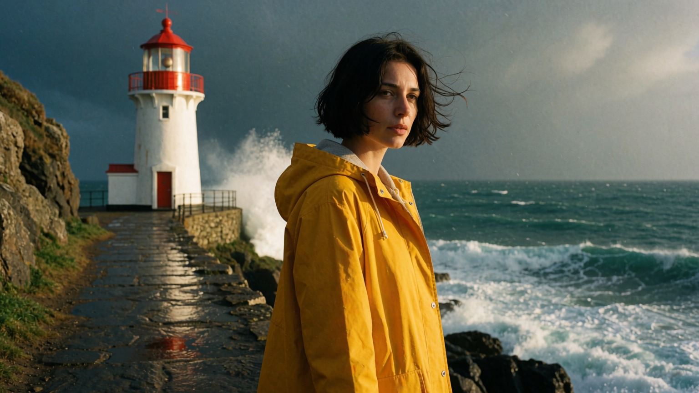
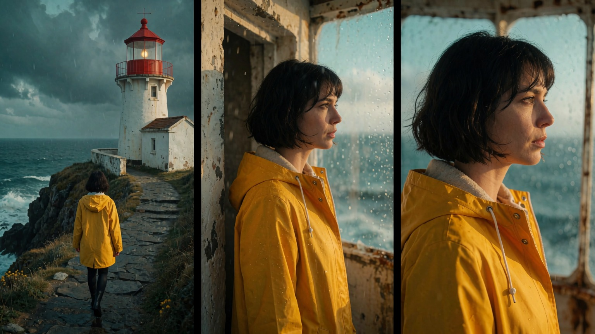
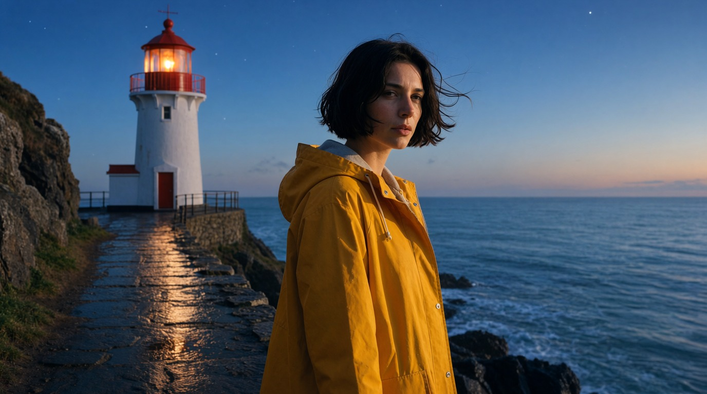

# After the storm / Dopo la tempesta

Real local outputs from the included API workflows, submitted directly to ComfyUI. The person is fictional. README images are JPEG exports; no generative retouching was applied after the workflows.

Risultati locali reali dei workflow API inclusi, inviati direttamente a ComfyUI. Il personaggio è immaginario. Le immagini del README sono esportate in JPEG, senza ritocchi generativi successivi.

## lighthouse-hero



- Workflow: `workflows/krea2_turbo_api.json`
- Output: 1536 × 864
- Seed: 22102026
- Optional LoRAs / LoRA opzionali: none / nessuno

- First pass: 8 steps, linear/euler, simple, CFG 1.
- Second pass: 2 of 8 steps, exponential/res_2s, bong_tangent, denoise 0.2, CFG 1.
- Krea enhancer: enabled, strength 1.5.

### Prompt

```text
A fictional adult woman aged 32 with a short dark bob haircut, wearing a vivid mustard yellow raincoat, stands on a weathered stone coastal path beside a white lighthouse with a red lantern room. The Atlantic ocean, dramatic cliffs and crashing waves surround her. Single cinematic editorial photograph, wide composition, woman in right foreground seen in three-quarter profile, lighthouse on the left in the middle distance. A break in dark storm clouds sends a shaft of warm late afternoon sunlight across her face and the lighthouse. Sea spray, wet stone reflections, teal ocean against yellow raincoat, wind moving her hair, natural skin texture. Shot on 35mm film, sophisticated natural color, realistic exposure, tactile details, visually striking but believable. No text, no logos, no collage.
```

## lighthouse-storyboard



- Workflow: `workflows/krea2_turbo_api.json`
- Output: 1536 × 864
- Seed: 22102026
- Optional LoRAs / LoRA opzionali: none / nessuno

- First pass: 8 steps, linear/euler, simple, CFG 1.
- Second pass: 2 of 8 steps, exponential/res_2s, bong_tangent, denoise 0.2, CFG 1.
- Krea enhancer: enabled, strength 1.5.

### Prompt

```text
Exactly three equal-sized vertical cinematic panels side by side in a single horizontal row, separated by thin straight black gutters. A fictional adult woman aged 32 with a short dark bob haircut, wearing a vivid mustard yellow raincoat, stands on a weathered stone coastal path beside a white lighthouse with a red lantern room. The Atlantic ocean, dramatic cliffs and crashing waves surround her. Same woman, yellow raincoat and lighthouse in every panel. Left panel: wide shot of her walking up the cliff path towards the lighthouse under storm clouds. Middle panel: medium side-profile portrait at the lighthouse doorway, rain droplets on her yellow coat, warm light spilling outside. Right panel: close-up of her face looking out over the ocean from the lantern room, warm sunlight on her skin, softly blurred sea behind her. Photorealistic film stills, teal and warm yellow color palette, natural skin, dramatic cinematic light. No lettering, no labels, no extra panels.
```

## lighthouse-edit



- Workflow: `workflows/qwen_image_2.1_edit_api.json`
- Output: 1376 × 768
- Seed: 22102026
- Optional LoRAs / LoRA opzionali: none / nessuno

- Steps: 30; CFG: 1; sampler: euler; scheduler: simple; denoise: 1
- Input: lighthouse-hero; input scaling: 1 megapixel.

### Prompt

```text
Keep the exact same woman, face, yellow raincoat, pose, lighthouse, camera angle and composition. Change only the weather and lighting to a peaceful clear blue-hour evening after the storm. Calm the sea, add the first faint stars, and turn on a warm amber light in the lighthouse lantern room. Preserve photographic realism, natural skin texture and all architectural details. No text.
```

## What to compare / Cosa confrontare

The Qwen edit changes the weather, sea and lighthouse lighting while broadly preserving the subject and composition. Fine details can change. The storyboard is a separate text-guided three-panel generation, not three reference-conditioned images or a video.

La modifica Qwen cambia meteo, mare e illuminazione del faro conservando nel complesso soggetto e composizione. I dettagli possono cambiare. Lo storyboard è una generazione separata di tre pannelli guidata dal testo, non tre immagini condizionate dal riferimento né un video.


[Earlier example: The Observatory / Esempio precedente](OBSERVATORY_EXAMPLE.md)

## Lighthouse video / Video del faro

- Workflow: `workflows/ltx2.5_api.json`, prepared through the app's `prepara_workflow_ltx_video` adapter and submitted to ComfyUI.
- Input: lighthouse-hero PNG, first-frame conditioning, no last frame.
- Seed: 21102026; requested duration: 4 seconds; 24 fps; resolution selector: 480p; aspect ratio: 16:9; optional LoRAs: none.
- Actual output: 896 × 512, 97 frames, 4.04 seconds. The adapter aligns dimensions and frame count to workflow constraints. Both workflow passes were retained.
- `lighthouse-ltx.mp4` is the generated output; `lighthouse-preview.gif` is a 560 × 320, approximately 8 fps silent preview.

```text
Cinematic static medium-wide shot of a woman in a yellow raincoat beside a white lighthouse. Preserve the composition and her face from the reference image. Wind gently moves her short dark hair and coat. The ocean waves roll towards the rocks and break into white spray behind her. She quietly looks towards the sea with a subtle natural head movement. Warm sunlight breaks through storm clouds. Natural wind and ocean sounds. No speech, no music, no cuts.
```
