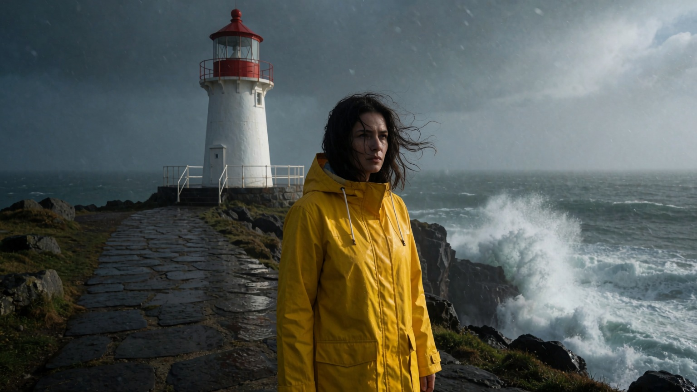
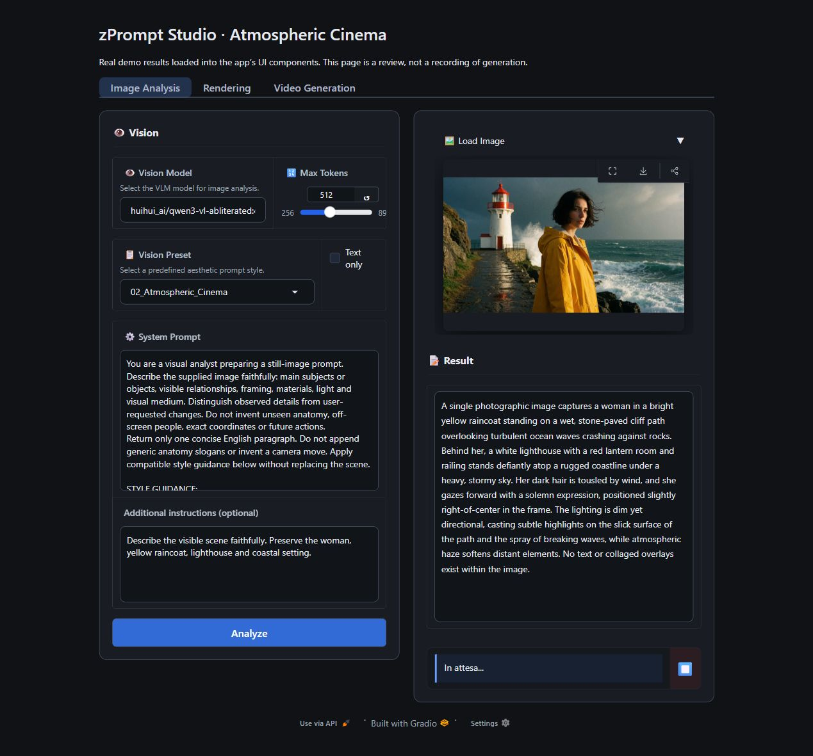

# Prima prova: dall’analisi al video

Percorso consigliato per provare la beta. La prova usa una scena del faro con un personaggio immaginario e lo stile **02_Atmospheric_Cinema**. I risultati generativi possono variare: è un percorso ripetibile, non una promessa di immagini identiche.

## Prima di iniziare

Segui l’[installazione](README.it.md#primi-passi), configura ComfyUI e usa **Verifica installazione**. Prepara i modelli e i nodi di **Krea-2 Turbo** e **LTX 2.5**, seguendo la [guida download](../help/model-downloads.html). Per questo percorso non servono LoRA opzionali. Il VLM consigliato è Qwen3-VL 4B abliterated; al primo uso può richiedere un download separato.

La macchina locale di riferimento ha una RTX 3090 Ti da 24 GB e 32 GB di RAM: non è un requisito minimo certificato. Risoluzione, modelli e memoria disponibile determinano la fattibilità. Primo download, caricamento dei pesi e generazione sono attese diverse; guarda stato e registri. Non scaricare tutti i modelli del catalogo.

## 1. Analisi

Salva l’[immagine del faro](assets/lighthouse-hero.jpg). Nel tab Analisi disattiva Solo testo, carica l’immagine e scegli **02_Atmospheric_Cinema**. Nelle istruzioni aggiungi:

> Descrivi fedelmente la scena visibile. Mantieni donna, impermeabile giallo, faro e ambiente costiero. Una sola immagine fotografica, senza scritte o collage.

Avvia Analizza. Controlla che il prompt sia in inglese e descriva ciò che è visibile, senza personaggi o oggetti aggiunti. Il preset definisce luce e trattamento visivo, non cambia la storia.

## 2. Rendering

Usa il prompt dell’analisi nel tab Rendering. Scegli Krea-2 Turbo, modalità classica, una copia, 1536 × 864 e nessun LoRA opzionale. Per una prova confrontabile imposta seed fisso **6112026**; mantieni le due fasi del workflow incluso. Genera e controlla il risultato.

Questa è una nuova generazione da descrizione: non garantisce lo stesso volto dell’immagine analizzata. Per una modifica che conservi il soggetto serve il percorso di editing, escluso da questa prima prova.

## 3. First Frame e idea

Seleziona **F** sull’immagine appena generata. Nel tab Video verifica che compaia come First Frame; disattiva Solo testo e non impostare un Last Frame. Scegli LTX 2.5 e lo stile di regia **02_Atmospheric_Cinema**. Scrivi:

> La donna rivolge lentamente lo sguardo al mare. Il vento muove delicatamente capelli e impermeabile giallo. Camera fissa, solo onde e vento; niente musica, niente dialoghi, nessun taglio.

Usa Crea/migliora soggetto e verifica che resti breve e conservi questi vincoli. Correggi eventuali dettagli non desiderati prima di continuare.

## 4. Timeline e prompt video

Imposta **10 secondi**, poi genera la timeline. Il percorso attuale prevede tre segmenti: 0–3,3; 3,3–6,6; 6,6–10 secondi. Devono descrivere un’azione continua, senza cambi di camera o tagli richiesti soltanto dallo stile. Mantieni onde e vento, senza musica o parlato.

Crea il prompt video. Verifica che riporti gli stessi intervalli e conservi volto, abiti, ambiente e azioni del frame. Non confondere il numero di segmenti della timeline con il numero di video generati.

## 5. Video

Imposta 480p, 16:9, 24 fps, una copia, seed fisso **6112026**, senza LoRA opzionali. Avvia la generazione e attendi entrambe le fasi. Le dimensioni e i frame effettivi vengono adattati ai vincoli di LTX; la durata del file può differire leggermente dai 10 secondi richiesti.

Controlla continuità del volto e dell’abito, movimento, camera e suono. Per estendere il video, Estendi imposta il frame di raccordo ma conserva i testi: aggiorna idea, timeline e prompt per descrivere cosa succede dopo.

## Presentare la prova

Registra il percorso reale, distinguendo download, caricamento e generazione; dichiara tagli e accelerazioni. Mostra anche le correzioni manuali, se necessarie. I vecchi esempi nel README non sono la registrazione di questa prova.

Annota versione/commit, GPU, workflow, impostazioni e tempi. Prima di condividere registri elimina percorsi e contenuti personali. La verifica da installazione pulita e una registrazione completa della UI sono verifiche distinte dalla prova tecnica tramite le funzioni dell’app.

### Correzione emersa nella prova

Nella prova tecnica il compilatore ha mantenuto i tre intervalli corretti senza una seconda generazione, ma non ha ripetuto esplicitamente i vincoli niente musica/parlato e nessun taglio. Prima di generare è stata aggiunta manualmente la frase: `Continuous shot, no cuts. No music. No speech.` Questo intervento fa parte del risultato documentato.

[Prompt / Timeline](assets/creator-demo/prompts.json)

## Risultato e limiti della prova

[Apri il video generato](assets/creator-demo/video.mp4).

Prova tecnica del 6 novembre 2026 con le funzioni dell’app e ComfyUI locale: analisi 95,3 secondi incluso caricamento VLM; immagine 168,52 secondi; video 1027,54 secondi (circa 17 minuti), inclusi caricamenti. Non sono tempi garantiti. Il tentativo video precedente è stato interrotto per correggere il prompt e non rientra nel tempo dell’esecuzione riuscita.

Il video contiene 241 fotogrammi, 896 × 512, 24 fps e audio AAC stereo. Entrambi i flussi si decodificano senza errori. I fotogrammi controllati mantengono il soggetto e l’ambiente ma mostrano un cambio d’inquadratura nonostante la camera fissa richiesta. Il contenuto audio non è stato valutato separatamente all’ascolto. Non presentiamo il risultato come perfetta aderenza al prompt.

Questa prova usa l’ambiente locale esistente: non certifica una nuova installazione pulita né una registrazione completa dei click nella UI.

