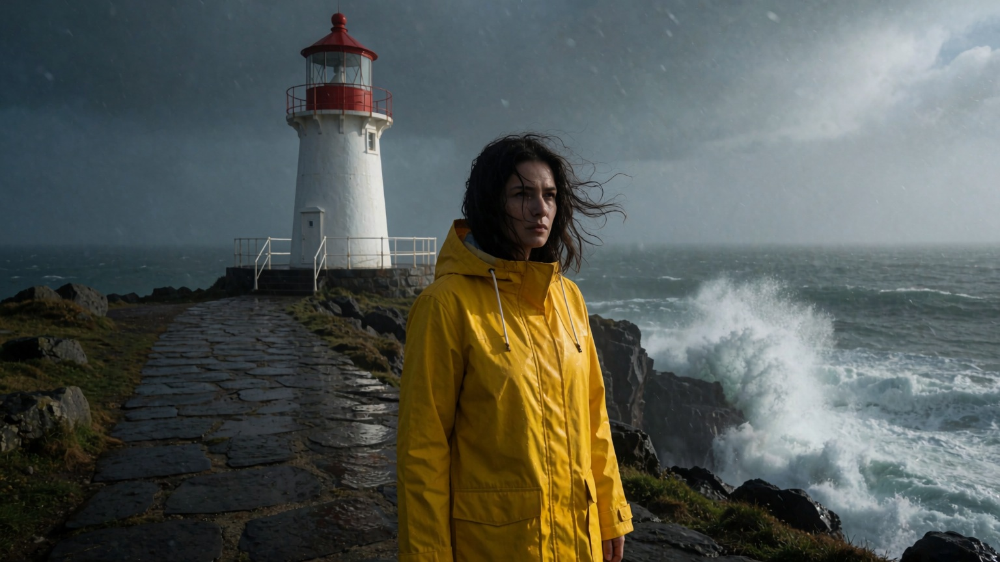
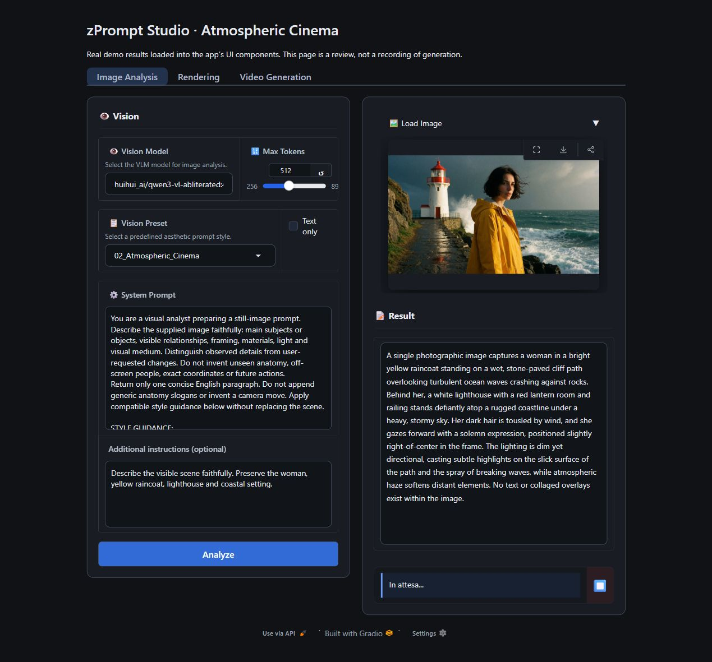

# First run: from image analysis to video

A guided beta trial using the lighthouse scene, a fictional character and **02_Atmospheric_Cinema** throughout. This is a repeatable procedure, not a guarantee of identical generated results. [Italiano](FIRST_RUN.it.md)

## Before starting

Follow [installation](README.md#get-started), configure ComfyUI and run **Check installation**. Install the models and custom nodes for **Krea-2 Turbo** and **LTX 2.5**, following the [download guide](../help/model-downloads.en.html). No optional LoRAs are needed. Choose Qwen3-VL 4B abliterated for analysis and prompt creation; its first use may require a separate download.

The local reference machine has an RTX 3090 Ti with 24 GB VRAM and 32 GB RAM; this is not a certified minimum requirement. Model choice, resolution and free memory affect feasibility. Downloads, weight loading and generation are separate waits. Watch progress and logs; do not download every model in the catalog.

## 1. Analyze the reference

Save the [lighthouse image](assets/lighthouse-hero.jpg). In Analysis, disable Text only, load it and select **02_Atmospheric_Cinema**. Add:

> Describe the visible scene faithfully. Preserve the woman, yellow raincoat, lighthouse and coastal setting. One photographic image, no text or collage.

Run Analyze. Check that the English prompt describes visible content without adding characters or objects. The style controls visual treatment, not story events.

## 2. Render an image

Use the analysis prompt in Rendering. Select Krea-2 Turbo, classic mode, one copy, 1536 × 864, no optional LoRAs and fixed seed **6112026**. Keep both passes of the included workflow. Generate and inspect the result.

This creates a new image from a description; it does not guarantee the reference person's exact identity. Identity-preserving modifications belong to the editing workflow, outside this first trial.

## 3. Set the first frame and idea

Select **F** on the new image. In Video, verify the First Frame preview, disable Text only and leave Last Frame empty. Select LTX 2.5 and director style **02_Atmospheric_Cinema**. Enter:

> The woman slowly turns her gaze toward the sea. Wind gently moves her hair and yellow coat. Keep the camera fixed, with waves and wind only; no music, no speech, no cuts.

Create/improve the subject. Check that the idea stays concise and preserves these constraints. Correct unwanted details before continuing.

**Explore freely:** with the first frame selected and Text only disabled, leave the subject empty and click **Create / Enhance Subject**. AI suggests an action from the image. Continue with timeline, prompt and video, starting each step separately. To reproduce this demo, use the supplied text above instead.

## 4. Create the timeline and final prompt

Set **10 seconds**, then create the timeline. The current procedure produces three spans: 0–3.3, 3.3–6.6 and 6.6–10 seconds. These should describe continuous action, without stylistically invented cuts or camera moves. Keep waves and wind, no speech or music.

Create the video prompt. Check the same boundaries and consistency with the first frame's subject, wardrobe, setting and action. Timeline segments are not separate generated video files.

## 5. Generate video

Choose 480p, 16:9, 24 fps, one copy, fixed seed **6112026**, no optional LoRAs. Generate and wait for both passes. LTX adjusts dimensions and frame count to its constraints; file duration can differ slightly from the requested 10 seconds.

Inspect face and wardrobe continuity, motion, framing and sound. Extend video sets the junction frame but keeps the existing text: update the idea, timeline and prompt to describe what happens next.

## Presenting the trial

Record the actual sequence, distinguish downloads/loading/generation and disclose cuts or speedups. Include manual corrections when needed. The older README examples are not a recording of this trial.

Record the version/commit, GPU, workflow, settings and elapsed times. Remove personal paths and content before sharing logs. A clean-install trial and a complete UI recording are separate checks from exercising the app's generation functions directly.

### Review correction found during the trial

The technical trial preserved all three intervals without a second generation, but the final compiler did not explicitly repeat the no-music/no-speech/no-cuts constraints. Before video generation we manually added: `Continuous shot, no cuts. No music. No speech.` This intervention is part of the documented result.

[Prompt / Timeline](assets/creator-demo/prompts.json)

## Result and trial limitations

[Open the generated video](assets/creator-demo/video.mp4).

Technical trial on November 6, 2026 using the app’s functions and local ComfyUI: analysis 95.3 seconds including VLM loading; image 168.52 seconds; video 1027.54 seconds (about 17 minutes), including loading. These are not guaranteed timings. An earlier video attempt was interrupted to correct the prompt and is excluded from the successful run’s timing.

The video contains 241 frames at 896 × 512, 24 fps, with stereo AAC audio. Both streams decode without errors. Inspected frames retain the subject and setting but show reframing despite the requested static camera. Audio content has not been separately assessed by listening. This is not presented as perfect prompt adherence.

This trial uses the existing local environment: it does not certify a new clean installation or a complete recording of UI interactions.

