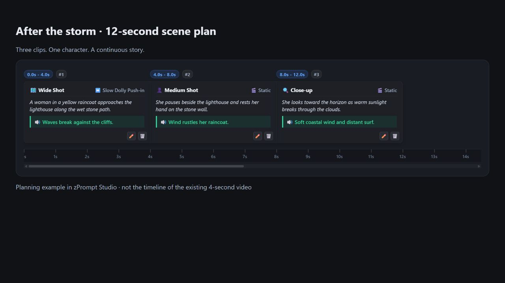

<b>Dalle idee e dalle immagini di riferimento a immagini, storyboard e video.</b> Un unico spazio Gradio, con modelli locali e workflow ComfyUI.

<a href="README.md">English</a> · <b>Italiano</b>

[Avvio rapido](#provala-su-windows) · [Interfaccia](#dentro-lo-studio-un-esempio-concreto) · [Guida IT / EN](../help/README.md) · [Download modelli](../help/model-downloads.html) · [Esempi](EXAMPLES.md)

> **Preview per il collaudo dell’installazione.** ComfyUI e i suoi modelli vanno installati separatamente. Le dipendenze Windows incluse sono pensate per GPU NVIDIA.

## Provala su Windows

1. Installa **Python 3.11 a 64 bit**, con Python Launcher. Per aggiornare automaticamente serve anche **Git per Windows**.
2. Clona il repository oppure usa **Code → Download ZIP**, estraendo tutto in una cartella scrivibile.
3. Esegui **`zPrompt_Studio.bat`**: se mancano l’ambiente o le dipendenze principali, avvia automaticamente l’installazione. Lascia aperto il terminale e segui i messaggi.
4. In **Registri e impostazioni → ComfyUI locale**, incolla la cartella Windows Portable, premi **Verifica e salva cartella** e riavvia Studio. ComfyUI va installato separatamente, insieme ai modelli e ai nodi necessari per il workflow scelto. Per un server remoto puoi configurare `COMFYUI_URL` in `data/settings.json`.
5. Prova prima un prompt da testo: attiva **Solo testo** e compila **Descrivi l’immagine da creare**. Al primo utilizzo può essere scaricato il modello LLM/VLM. Poi prova una singola generazione immagine.

Sono inclusi sorgenti, workflow JSON e preset generici. ComfyUI, pesi dei modelli, LoRA e sessioni personali sono esclusi. Gli LLM/VLM possono essere scaricati al primo utilizzo; i modelli di generazione devono essere disponibili in ComfyUI. RAM, VRAM, spazio disco e download dipendono dai modelli scelti.

**[Istruzioni complete](../docs/LEGGIMI_INSTALLAZIONE.md)** · **[Workflow](../workflows)** · **[Configurazione di esempio](../config/settings.example.json)**

Dettagli delle cartelle: ComfyUI e LoRA

### Impostare la cartella ComfyUI

In **Registri e impostazioni → ComfyUI locale**, incolla il percorso della cartella Windows Portable che contiene `python_embeded` e `ComfyUI` (non la cartella `models`). Premi **Verifica e salva cartella**, poi riavvia Studio. Se selezioni la sottocartella `ComfyUI`, Studio riconosce automaticamente la cartella principale. Un percorso non valido non sostituisce quello salvato. Questa funzione non installa ComfyUI.

### Cartelle LoRA

Ogni famiglia usa una cartella sotto `ComfyUI/models/loras`: `Z-Image`, `Flux-2`, `Krea-2`, `Qwen2.1`, `LTX-2.5`, `MiniMax`. I percorsi in `data/settings.json` derivano da `{COMFYUI_DIR}`: basta impostare la cartella ComfyUI principale. Le vecchie cartelle `Z-Image1` e `Z-Image2`, se presenti, restano leggibili per compatibilità; i nuovi LoRA Z-Image vanno in `Z-Image`. Nessun modello viene spostato automaticamente.

## Un’idea. Tre modi di raccontarla.

**Dopo la tempesta** — un impermeabile giallo, un faro e un raggio di luce sull’Atlantico. Generata localmente con Krea-2 Turbo e il workflow incluso nell’app.

## Dentro lo studio: un esempio concreto

**Dallo stesso riferimento, un percorso completo tra prompt, immagini e movimento.** Le schermate mostrano i componenti reali dell’app in una sessione dimostrativa in inglese, con prompt ed esempi del faro precaricati. Le immagini e il video sono risultati reali dei workflow inclusi; non è una registrazione di una nuova generazione.

### Il riferimento diventa una descrizione

Immagine, istruzioni personalizzabili e prompt affiancati: puoi leggere e correggere ogni dettaglio prima di generare.

### Il prompt prende forma

Scegli il workflow, affina la descrizione e confronta i risultati nella galleria. I controlli F e L collegano le immagini alla preparazione del video.

### La scena entra in movimento

Idea, tempi, azione, suono e primo frame nello stesso spazio di lavoro. Il player mostra il video LTX2.5 dell’esempio.

*Clicca sulle schermate per vederle a dimensione intera. La UI è disponibile anche in italiano.*

### Pianifica una sequenza di tre clip

Esempio di pianificazione di 12 secondi, ottenuto con il componente timeline reale. Non corrisponde al video dimostrativo di 4 secondi.

## Dall’immagine al movimento

LTX2.5, primo frame dalla scena Krea: **896 × 512, 24 fps, 97 fotogrammi** (circa 4 secondi). La GIF è un’anteprima ridotta senza audio. [Apri/scarica il video MP4](../docs/assets/lighthouse-ltx.mp4).

Altri esempi: modifica immagine e storyboard

## Altri risultati dello stesso progetto

### Cambia l’atmosfera, conserva la scena

| Originale · Krea-2 Turbo | Modifica · Qwen Image 2.1 |
| --- | --- |
|  |  |

La richiesta di editing: trasformare la tempesta in una sera tranquilla, mantenendo personaggio, impermeabile e composizione. Confronta i risultati: la conservazione dei dettagli non è perfetta.

### Dalla scena allo storyboard

Tre pannelli generati insieme con Krea-2 Turbo: arrivo al faro, ingresso, sguardo sul mare. È una nuova generazione guidata dal testo; la continuità del personaggio è approssimativa.

**Risultati reali dei workflow inclusi, eseguiti in ComfyUI.** Nessuna fotografia di repertorio. [Prompt, seed e parametri per riprovare gli esempi →](../docs/EXAMPLES.md)

## Cosa puoi fare

| Area | Funzioni |
| --- | --- |
| Analisi | Descrivere immagini di riferimento e sviluppare prompt con un modello visivo locale. |
| Rendering | Generare immagini, affinare prompt, selezionare LoRA e modificare immagini esistenti. |
| Storyboard e sequenze | Preparare pannelli e scatti con descrizioni di personaggi, ambienti e azioni. |
| Video | Sviluppare idea, timeline e prompt finale, poi usare il workflow ComfyUI scelto. Gli ingressi disponibili dipendono dal workflow. |
| Batch | Elaborare più immagini. La generazione automatica di video in batch non è inclusa. |
| Registri e impostazioni | Configurare i percorsi e consultare la diagnostica dei workflow. |

## Suggerimenti personalizzabili

**I suggerimenti inclusi sono esempi preparati dall’autore: puoi modificarli, aggiungerne di tuoi e costruire una libreria adatta al tuo stile.** Non sono obbligatori né una raccolta chiusa.

I preset coprono analisi visiva, regia, idee di sceneggiatura, storyboard e sequenze. Sono semplici file di testo; i cataloghi delle sequenze includono anche personaggi, ambienti/abiti e azioni. [Come creare e personalizzare i suggerimenti →](../docs/CUSTOM_PRESETS.md)

## Aggiornamenti

Chiudi l’app ed esegui **`update.bat`** da un clone Git. Aggiorna dal ramo remoto configurato e installa le dipendenze; si ferma se trova modifiche locali o commit divergenti. Non aggiorna ComfyUI e non scarica i modelli di generazione.

Le copie ZIP non hanno la cronologia Git: scarica la nuova versione in una cartella separata. Impostazioni, sessioni, output e cache sono esclusi da Git. Chiudi l’altra istanza dell’app se entrambe utilizzano lo stesso ComfyUI.

Diagnostica, stato della preview e cartelle del progetto

## Stato della preview

- Risoluzione delle dipendenze verificata per Windows/Python 3.11; versioni transitive fissate in `scripts/constraints-win-py311.txt`.
- Collegamenti dei workflow e callback dell’interfaccia verificati. Restano da collaudare l’installazione da zero e tutte le combinazioni di modelli e workflow.
- Le guide offline italiana e inglese sono incluse: usa **?** e scegli la lingua oppure apri `help/help.html` / `help/help.en.html`.
- Presentazione destinata alla revisione privata: non costituisce una pubblicazione o una concessione di licenza.

Per segnalare un problema indica modello/workflow, passaggi per riprodurlo e log pertinenti, rimuovendo dati personali e credenziali.

Il programma di installazione esegue anche un controllo di Python, dipendenze, GPU/CUDA, cartelle e ComfyUI. Ripetilo con `scripts/check_installation.bat` oppure da **Registri e Impostazioni → Diagnostica → Verifica installazione**. Avvia ComfyUI per verificare nodi e modelli dei workflow. `CONFIG` indica requisiti da configurare o verificare per le funzioni desiderate; il controllo non scarica modelli e non certifica una generazione completa.

I suggerimenti di sistema sono personalizzabili senza modificare Python: consulta la [guida ai template e alle personalizzazioni locali](../suggestions/system/README.md).

### Cartelle del progetto

Avvia e aggiorna con i due `.bat` nella cartella principale. Il file di avvio richiama automaticamente l’installazione quando mancano l’ambiente o le dipendenze principali. Puoi anche installare con `scripts/install.bat`; esegui la diagnostica con `scripts/check_installation.bat`. Il piccolo `requirements.txt` nella radice mantiene compatibili gli aggiornamenti dalle vecchie versioni.

- `config/`: catalogo modelli, parametri workflow e impostazioni di esempio.
- `scripts/`: programma di aggiornamento e vincoli delle dipendenze.
- `docs/`: istruzioni di installazione, attribuzioni e manifesto dei file.
- `workflows/`: workflow API e profili modificabili.
- `suggestions/`: istruzioni per i prompt ed esempi personalizzabili.
- `help/`: guida illustrata.

Impostazioni e sessioni personali sono in `data/`, esclusa da Git. I vecchi file vengono trasferiti automaticamente all’avvio. Installazione e diagnostica sono in `scripts/`.

