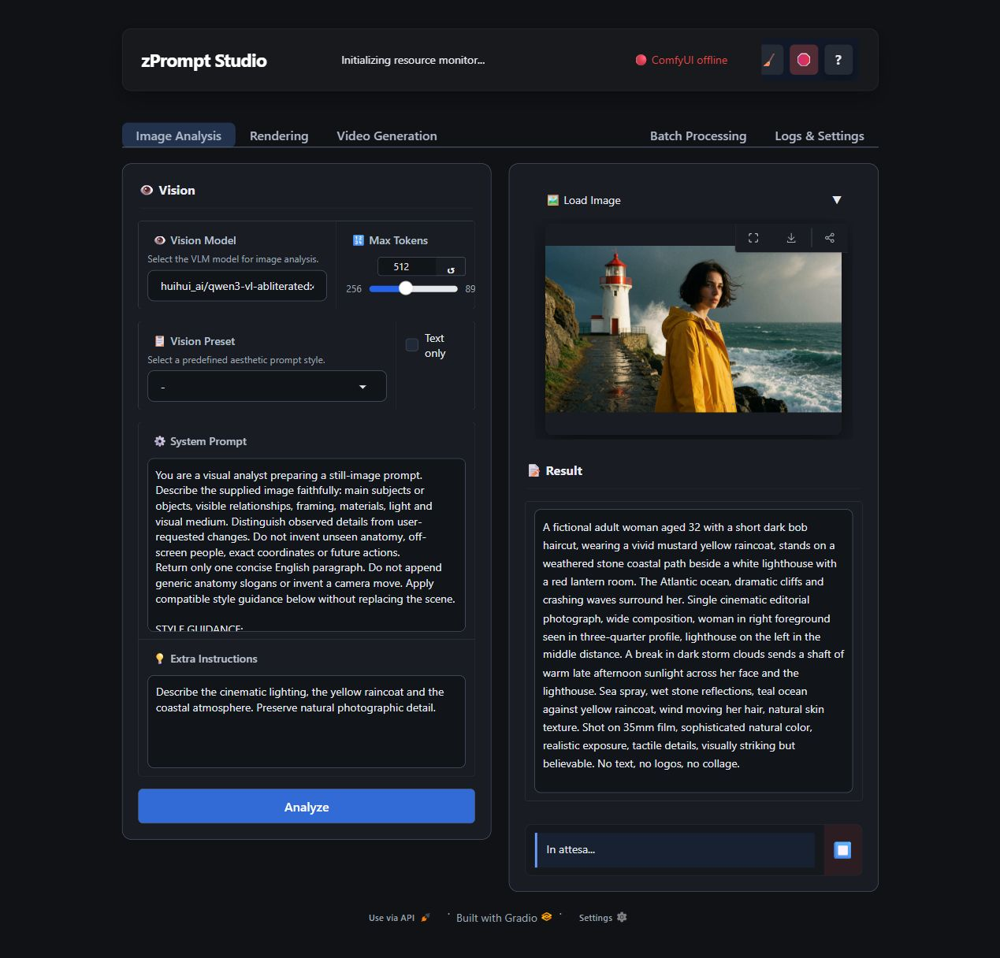
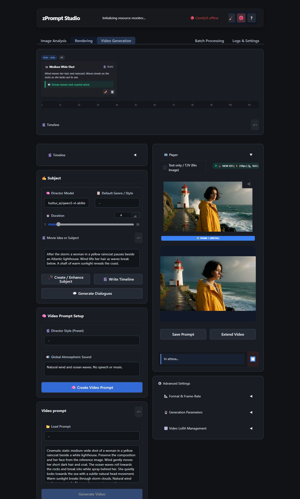

# zPrompt Studio

**Parti da un’immagine o da poche parole. L’AI ti aiuta a trasformarle in immagini e video, sul tuo computer.**

Non servono un’idea già completa o un prompt scritto alla perfezione. zPrompt Studio ti aiuta a sviluppare la scena, scrivere prompt modificabili e pianificare le azioni del video, usando modelli AI locali e ComfyUI.

**Il tuo spunto → Idea e prompt con l’AI → Immagini → Timeline → Video**

**Fallo diventare il tuo spazio creativo:** trasforma le tue idee di cinema, fotografia e illustrazione in suggerimenti riutilizzabili. Parti dagli esempi inclusi, crea i tuoi stili e, quando vuoi, personalizza i workflow ComfyUI compatibili. [Scopri le personalizzazioni](#rendilo-tuo).

[English](README.md) · **Italiano**

[Interfaccia](#dentro-lapp) · [Demo](#guarda-la-demo) · [Primi passi](#primi-passi) · [Guida](#guide-e-personalizzazione)

> **Beta · Windows · GPU NVIDIA.** ComfyUI, i suoi nodi aggiuntivi e i modelli di generazione vanno preparati separatamente. I requisiti hardware dipendono dai modelli scelti.

## Dentro l’app

Puoi partire da testo, da un’immagine di riferimento o da un prompt già pronto. Non è necessario seguire tutte le schede in ordine.

| Analisi | Rendering | Video |
| --- | --- | --- |
|  |  |  |
| Trasforma testo o riferimenti in un prompt immagine modificabile. | Genera o modifica immagini, affina le descrizioni e confronta i risultati. | Ricava un’idea dall’immagine con l’AI, crea la timeline e genera un video. |

*Clicca sulle schermate per ingrandirle. Sono componenti reali della UI con gli esempi del faro già caricati, non una registrazione della generazione. Alla prima installazione l’interfaccia parte in inglese. Puoi scegliere l’italiano in Logs & Settings; la scelta viene salvata.*

Sono inclusi anche:

- **Storyboard e sequenze:** prepara pannelli con personaggi, ambienti e azioni.
- **Stili condivisi:** riporta nel Video lo stile scelto per l’immagine, poi modificalo se necessario.
- **Immagini in batch:** elabora più immagini; la generazione automatica di video in batch non è inclusa.
- **Registri e diagnostica:** controlla progresso, requisiti dei workflow e configurazione.

## Guarda la demo

### Dall’immagine al video

**[Guarda il video generato](assets/lighthouse-ltx.mp4)** · **[Prova il percorso guidato dall’immagine al video](FIRST_RUN.it.md)**

Un’immagine generata diventa il primo frame di un video LTX 2.5. È movimento realmente generato dall’AI: circa quattro secondi, 896 × 512, 24 fps. La GIF è un’anteprima ridotta e senza audio; apri il video MP4 per l’esempio completo.

### Come ci arrivi

| Parti da… | L’AI ti aiuta a… | Tu puoi… |
| --- | --- | --- |
| Poche parole o un’immagine di riferimento | Sviluppare il prompt immagine in **Analisi**. | Scegliere lo stile e modificare la descrizione. |
| Il prompt immagine | Creare un’immagine in **Rendering**. | Scegliere il risultato e marcarlo **F** come primo frame. |
| Il frame selezionato, anche senza un’idea scritta | Proporre un breve soggetto con **Crea / Migliora Soggetto**. | Tenere la proposta o descrivere un’azione tua. |
| Il soggetto | **Scrivere la timeline**, poi **creare il prompt video**. | Controllare azioni, tempi, inquadrature e suoni. |
| Il prompt completo | **Generare il video** tramite il workflow ComfyUI scelto. | Guardare il risultato e perfezionarlo. |

**Puoi partire anche senza un’idea scritta:** seleziona un primo frame, disattiva Solo testo e lascia vuoto il soggetto. Premi **Crea / Migliora Soggetto**, poi **Scrivi Timeline → Crea Prompt Video → Genera Video**. L’AI prepara i contenuti; avvii ogni passaggio separatamente e puoi correggere i risultati.

*L’anteprima mostra un video finito, non una registrazione dell’intera sequenza nell’app. La guida collegata propone una prova distinta di dieci secondi, con le proprie impostazioni.*

### Una sola idea, tre stili visivi

**Above the Clouds** — immagini reali di Krea-2 Turbo, generate da testo usando gli stili condivisi.

**[Guarda la demo degli stili di 26 secondi](assets/sky-demo/above-the-clouds.mp4)** · [Riproducila: descrizione, stili e impostazioni](STYLE_DEMO.it.md)

*Un montaggio di immagini statiche, con le attese omesse. Questa seconda demo non mostra movimento generato dall’AI.*

Esplora gli esempi di timeline, editing e storyboard

### Pianifica le azioni nel tempo

Esempio distinto di pianificazione di 12 secondi con il componente timeline reale; non è la timeline dell’anteprima di quattro secondi mostrata sopra.

### Modifica una scena

| Originale · Krea-2 Turbo | Modifica · Qwen Image 2.1 |
| --- | --- |
|  |  |

La richiesta cambia meteo e atmosfera mantenendo soggetto e composizione. La conservazione dei dettagli non è perfetta.

### Crea uno storyboard

Una nuova generazione guidata dal testo; la continuità del personaggio è approssimativa. [Prompt, seed e impostazioni degli esempi](EXAMPLES.md).

## Primi passi

**Prima di iniziare:** installa Python 3.11 a 64 bit, con Python Launcher, e prepara ComfyUI con i nodi e i modelli del workflow che vuoi usare. Per gli aggiornamenti automatici dell’app installa Git per Windows. [Guida al download dei modelli](../help/model-downloads.html).

1. **Scarica:** clona il repository oppure scegli **Code → Download ZIP** ed estrai il contenuto in una cartella scrivibile.
2. **Avvia:** esegui **`zPrompt_Studio.bat`**. Se mancano l’ambiente o le dipendenze principali, l’installazione parte automaticamente. Lascia aperto il terminale.
3. **Collega ComfyUI:** in **Registri e impostazioni → ComfyUI locale**, premi **Scegli cartella** (oppure incolla il percorso) e seleziona la cartella Windows Portable che contiene `ComfyUI` e `python_embeded`. Premi **Verifica e salva cartella**, poi riavvia Studio. Se non trova né un server raggiungibile né una cartella locale valida, l’app mostra anche un riquadro di configurazione in alto.
4. **Prova un’immagine:** in Analisi attiva **Solo testo**, scrivi una descrizione e crea il prompt; poi genera in Rendering. Il modello LLM/VLM locale può essere scaricato al primo utilizzo.

Il download comprende l’app, i workflow e i preset di esempio. Non comprende ComfyUI, pesi dei modelli o LoRA.

**[Prova guidata dall’immagine al video](FIRST_RUN.it.md)** · [Installazione dettagliata](LEGGIMI_INSTALLAZIONE.md) · [Cartelle e diagnostica](SETUP_REFERENCE.it.md)

## Rendilo tuo

**I suggerimenti inclusi sono esempi da cui partire. La direzione creativa può essere la tua.**

- **Il tuo cinema, la tua fotografia, i tuoi stili visivi:** scrivi indicazioni riutilizzabili per luce, colori, composizione, movimenti di camera e atmosfera. Puoi creare, ad esempio, un’estetica documentaristica sobria, una fantascienza illuminata al neon o un tuo stile di ritratto.
- **Le tue storie e le tue scene:** aggiungi idee di soggetto e suggerimenti per personaggi, ambienti e azioni. Tieni lo stile visivo distinto dal contenuto della storia, per riutilizzarlo in scene diverse.
- **La tua direzione dall’immagine al video:** crea preset corrispondenti per immagini e video, mantenendo la stessa intenzione visiva lungo il percorso. I suggerimenti restano file di testo modificabili; per creare preset creativi non serve modificare Python.
- **I tuoi workflow di generazione:** gli utenti esperti possono modificare un workflow supportato in ComfyUI, esportarlo in formato API e configurare il profilo corrispondente per Studio. Le modifiche compatibili si gestiscono tramite profili; un diverso protocollo dei nodi o un’altra architettura del modello possono richiedere modifiche al codice. Non è un importatore universale di workflow.

**[Crea i tuoi suggerimenti](CUSTOM_PRESETS.md)** · [Stili condivisi per immagini e video](../suggestions/README.md) · **[Personalizza workflow e profili](../workflows/PROFILES.md)**

## Guide e personalizzazione

**I suggerimenti inclusi sono esempi modificabili, non una raccolta chiusa.** Crea stili visivi, idee di trama e istruzioni personali senza modificare il codice Python.

| Vuoi… | Apri… |
| --- | --- |
| Conoscere schede e opzioni | [Guida illustrata in italiano e inglese](../help/README.md), disponibile anche con **?** nell’app |
| Creare o modificare suggerimenti | [Preset personalizzati](CUSTOM_PRESETS.md) · [Stili condivisi](../suggestions/README.md) |
| Personalizzare le istruzioni di sistema | [Template e personalizzazioni locali](../suggestions/system/README.md) |
| Preparare i modelli dei workflow | [Download modelli](../help/model-downloads.html) · [File dei workflow](../workflows) |
| Riprodurre gli esempi | [Above the Clouds](STYLE_DEMO.it.md) · [Dall’immagine al video](FIRST_RUN.it.md) · [Altri esempi](EXAMPLES.md) |

La guida HTML funziona offline dopo aver scaricato il repository. GitHub ne mostra il sorgente: usa **?** nell’app oppure apri `help/help.html` sul computer.

## Aggiorna Studio

Chiudi l’app ed esegui **`update.bat`** da un clone Git. Aggiorna l’app e le sue dipendenze; si ferma in presenza di modifiche locali o commit divergenti. Non aggiorna ComfyUI e non scarica modelli di generazione.

Per un’installazione ZIP, scarica una nuova copia in una cartella separata. Impostazioni personali, sessioni, output e cache dei modelli sono esclusi da Git. [Configurazione e cartelle del progetto](SETUP_REFERENCE.it.md).

## Note sulla beta e segnalazioni

Ricontrolla i prompt e le timeline generati. **Estendi video** imposta un nuovo primo frame ma conserva i testi precedenti: aggiorna idea, timeline e prompt prima di continuare. I workflow personalizzati possono richiedere un profilo corrispondente; la UI non espone riferimenti multipli dedicati all’identità per MiniMax.

Per segnalare un problema indica i passaggi, il workflow/modello, la GPU e i messaggi di errore pertinenti. Rimuovi i dati personali prima di condividere i log. **Verifica installazione** controlla dipendenze, nodi e modelli; non li scarica e non certifica una generazione completa.

[Stato della preview e diagnostica](SETUP_REFERENCE.it.md) · [Attribuzioni di terze parti](THIRD_PARTY_NOTICES.md)
