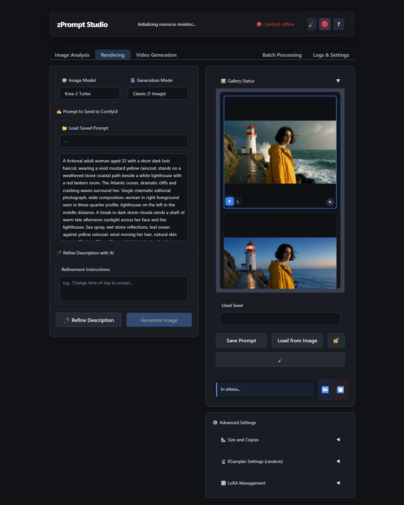
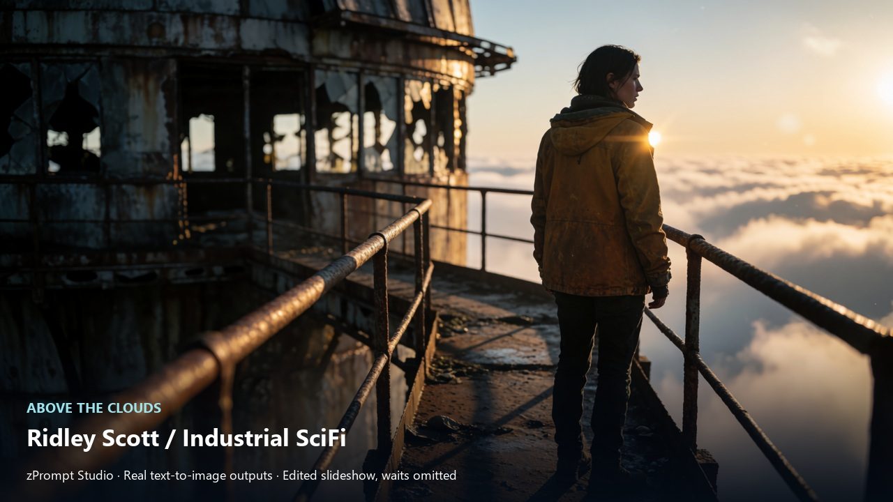

# zPrompt Studio

**Crea immagini, storyboard e video da idee e riferimenti.** Uno spazio di lavoro AI locale con prompt modificabili, stili visivi condivisi e workflow ComfyUI.

[English](README.md) · **Italiano**

[Interfaccia](#dentro-lapp) · [Demo](#guarda-la-demo) · [Primi passi](#primi-passi) · [Guida](#guide-e-personalizzazione)

> **Beta · Windows · GPU NVIDIA.** ComfyUI, i suoi nodi aggiuntivi e i modelli di generazione vanno preparati separatamente. I requisiti hardware dipendono dai modelli scelti.

## Dentro l’app

Puoi partire da testo, da un’immagine di riferimento o da un prompt già pronto. Non è necessario seguire tutte le schede in ordine.

| Analisi | Rendering | Video |
| --- | --- | --- |
|  |  |  |
| Trasforma testo o riferimenti in un prompt immagine modificabile. | Genera o modifica immagini, affina le descrizioni e confronta i risultati. | Sviluppa un’idea, organizza la timeline e genera un video. |

*Clicca sulle schermate per ingrandirle. Sono componenti reali della UI con gli esempi del faro già caricati, non una registrazione della generazione. L’interfaccia supporta inglese e italiano.*

Sono inclusi anche:

- **Storyboard e sequenze:** prepara pannelli con personaggi, ambienti e azioni.
- **Stili condivisi:** riporta nel Video lo stile scelto per l’immagine, poi modificalo se necessario.
- **Immagini in batch:** elabora più immagini; la generazione automatica di video in batch non è inclusa.
- **Registri e diagnostica:** controlla progresso, requisiti dei workflow e configurazione.

## Guarda la demo

**Above the Clouds** — una sola idea, tre interpretazioni visive. Risultati reali di Krea-2 Turbo, generati da testo usando gli stili condivisi.

**[Guarda la demo di 26 secondi](assets/sky-demo/above-the-clouds.mp4)** · [Riproducila: descrizione, stili e impostazioni](STYLE_DEMO.it.md)

*Il filmato è un montaggio di immagini statiche, con le attese omesse. Non mostra movimento generato dall’AI.*

Mostra gli esempi di timeline, video, editing e storyboard

### Pianifica le azioni nel tempo

Esempio di pianificazione di 12 secondi con il componente timeline reale. È distinto dal video di quattro secondi qui sotto.

### Dall’immagine al movimento

LTX2.5 con un’immagine generata come primo frame: 896 × 512, 24 fps, circa quattro secondi. La GIF è un’anteprima ridotta e senza audio. [Apri il video MP4](assets/lighthouse-ltx.mp4).

### Modifica una scena

| Originale · Krea-2 Turbo | Modifica · Qwen Image 2.1 |
| --- | --- |
|  |  |

La richiesta cambia meteo e atmosfera mantenendo soggetto e composizione. La conservazione dei dettagli non è perfetta.

### Crea uno storyboard

Una nuova generazione guidata dal testo; la continuità del personaggio è approssimativa. [Prompt, seed e impostazioni degli esempi](EXAMPLES.md).

## Primi passi

**Prima di iniziare:** installa Python 3.11 a 64 bit, con Python Launcher, e prepara ComfyUI con i nodi e i modelli del workflow che vuoi usare. Per gli aggiornamenti automatici dell’app installa Git per Windows. [Guida al download dei modelli](../help/model-downloads.html).

1. **Scarica:** clona il repository oppure scegli **Code → Download ZIP** ed estrai il contenuto in una cartella scrivibile.
2. **Avvia:** esegui **`zPrompt_Studio.bat`**. Se mancano l’ambiente o le dipendenze principali, l’installazione parte automaticamente. Lascia aperto il terminale.
3. **Collega ComfyUI:** in **Registri e impostazioni → ComfyUI locale**, indica la cartella Windows Portable che contiene `ComfyUI` e `python_embeded`. Premi **Verifica e salva cartella**, poi riavvia Studio.
4. **Prova un’immagine:** in Analisi attiva **Solo testo**, scrivi una descrizione e crea il prompt; poi genera in Rendering. Il modello LLM/VLM locale può essere scaricato al primo utilizzo.

Il download comprende l’app, i workflow e i preset di esempio. Non comprende ComfyUI, pesi dei modelli o LoRA.

**[Prova guidata dall’immagine al video](FIRST_RUN.it.md)** · [Installazione dettagliata](LEGGIMI_INSTALLAZIONE.md) · [Cartelle e diagnostica](SETUP_REFERENCE.it.md)

## Guide e personalizzazione

**I suggerimenti inclusi sono esempi modificabili, non una raccolta chiusa.** Crea stili visivi, idee di trama e istruzioni personali senza modificare il codice Python.

| Vuoi… | Apri… |
| --- | --- |
| Conoscere schede e opzioni | [Guida illustrata in italiano e inglese](../help/README.md), disponibile anche con **?** nell’app |
| Creare o modificare suggerimenti | [Preset personalizzati](CUSTOM_PRESETS.md) · [Stili condivisi](../suggestions/README.md) |
| Personalizzare le istruzioni di sistema | [Template e personalizzazioni locali](../suggestions/system/README.md) |
| Preparare i modelli dei workflow | [Download modelli](../help/model-downloads.html) · [File dei workflow](../workflows) |
| Riprodurre gli esempi | [Above the Clouds](STYLE_DEMO.it.md) · [Dall’immagine al video](FIRST_RUN.it.md) · [Altri esempi](EXAMPLES.md) |

La guida HTML funziona offline dopo aver scaricato il repository. GitHub ne mostra il sorgente: usa **?** nell’app oppure apri `help/help.html` sul computer.

## Aggiorna Studio

Chiudi l’app ed esegui **`update.bat`** da un clone Git. Aggiorna l’app e le sue dipendenze; si ferma in presenza di modifiche locali o commit divergenti. Non aggiorna ComfyUI e non scarica modelli di generazione.

Per un’installazione ZIP, scarica una nuova copia in una cartella separata. Impostazioni personali, sessioni, output e cache dei modelli sono esclusi da Git. [Configurazione e cartelle del progetto](SETUP_REFERENCE.it.md).

## Note sulla beta e segnalazioni

Ricontrolla i prompt e le timeline generati. **Estendi video** imposta un nuovo primo frame ma conserva i testi precedenti: aggiorna idea, timeline e prompt prima di continuare. I workflow personalizzati possono richiedere un profilo corrispondente; la UI non espone riferimenti multipli dedicati all’identità per MiniMax.

Per segnalare un problema indica i passaggi, il workflow/modello, la GPU e i messaggi di errore pertinenti. Rimuovi i dati personali prima di condividere i log. **Verifica installazione** controlla dipendenze, nodi e modelli; non li scarica e non certifica una generazione completa.

[Stato della preview e diagnostica](SETUP_REFERENCE.it.md) · [Attribuzioni di terze parti](THIRD_PARTY_NOTICES.md)
