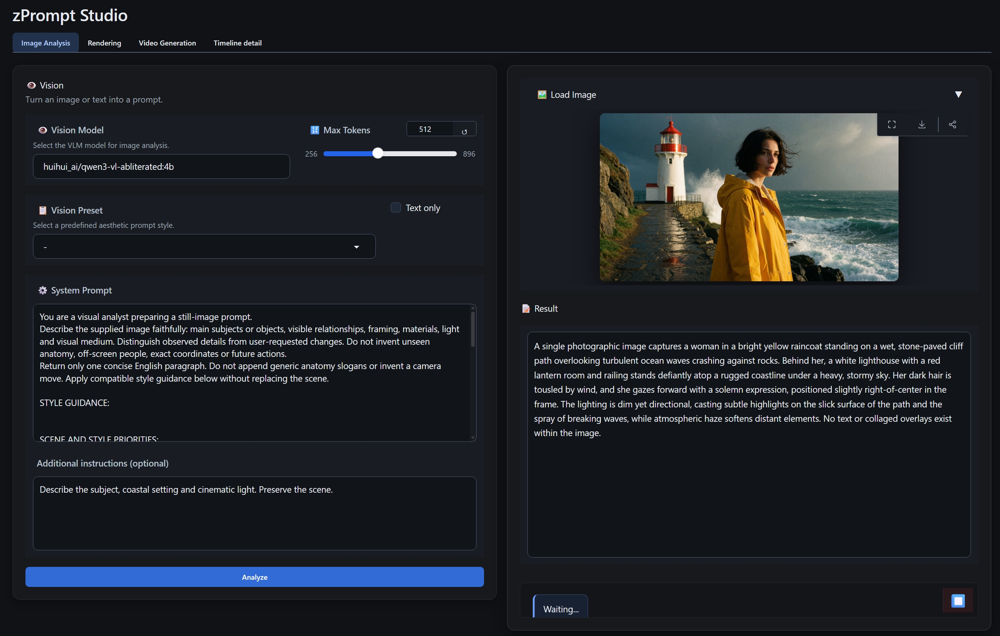
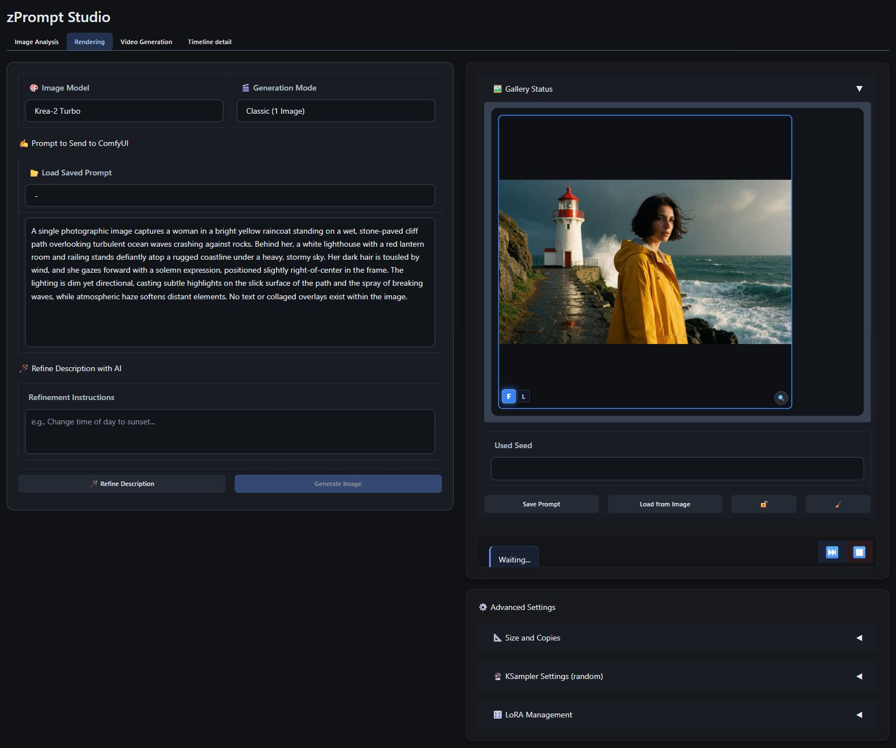
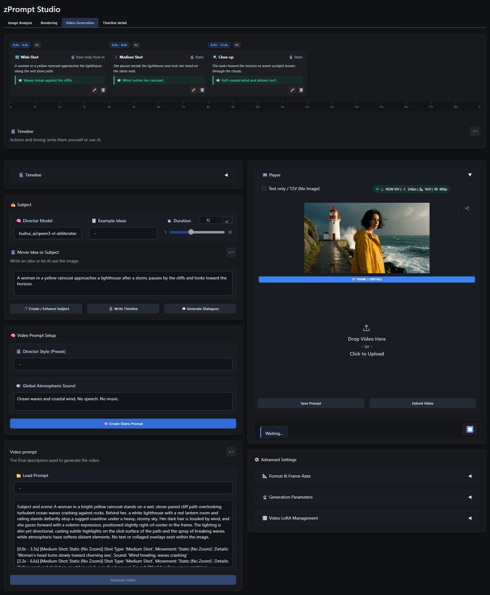
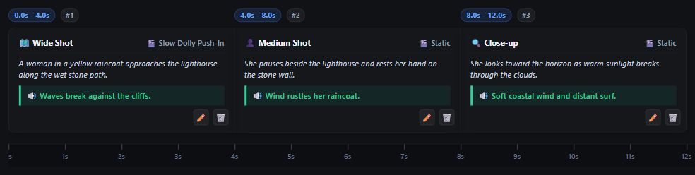
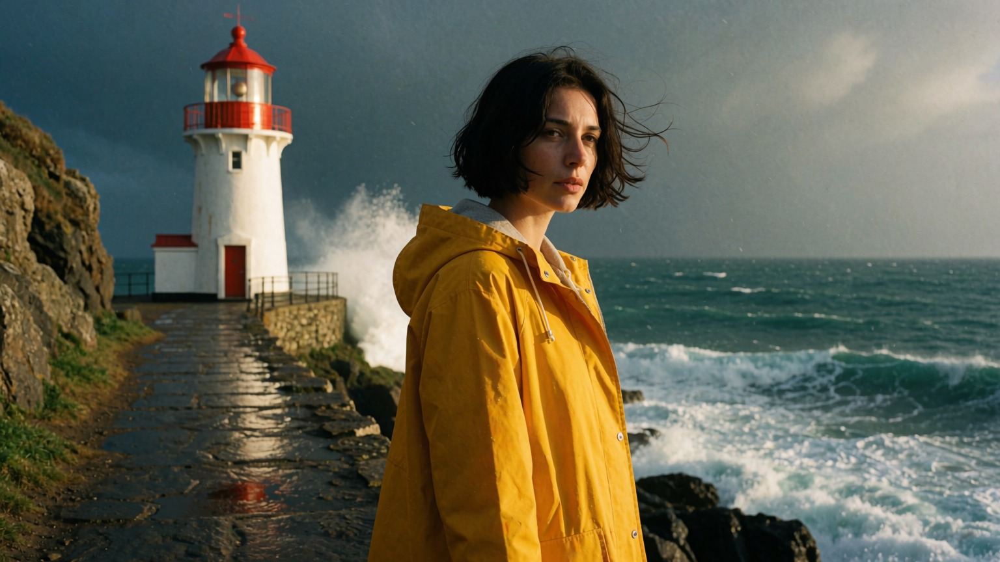
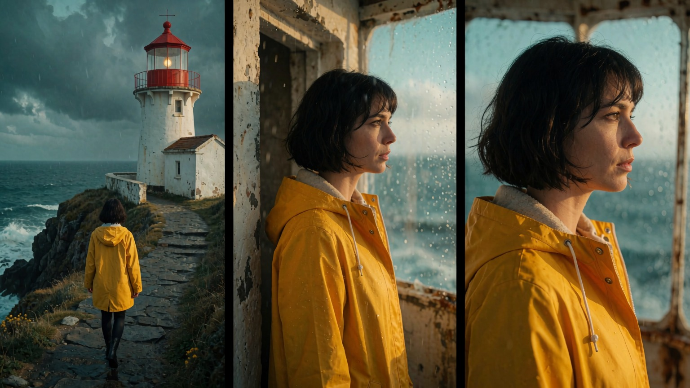

# zPrompt Studio

**Start with an image or a few words. Let AI help you turn them into images and video — on your own computer.**

You do not need a finished idea or a carefully written prompt. zPrompt Studio helps develop the scene, write editable prompts and plan video actions, using local AI models and ComfyUI.

**Your starting point → AI-assisted idea and prompts → Images → Timeline → Video**

**Make it your creative workspace:** turn your own ideas about cinema, photography and illustration into reusable suggestions. Start with the included examples, create your own styles and, when ready, customize compatible ComfyUI workflows. [Explore customization](#make-it-your-own).

**English** · [Italiano](README.it.md)

[Interface](#inside-the-app) · [Demo](#see-it-in-action) · [Get started](#get-started) · [Help](#guides-and-customization)

> **Beta · Windows · NVIDIA GPU.** ComfyUI, its custom nodes and generation models are required separately. Hardware needs depend on the selected models.

## Inside the app

Already have a prompt? Go straight to Rendering. You do not have to follow every tab in order.

### Analysis · find the right words

Turn a few words or a reference image into an editable image prompt.

### Rendering · bring the scene to life

Generate or edit images, refine the description and choose a result for your video.

### Video · give the image a story

Let AI suggest a subject from your image, plan actions and sound, then generate a video.

### Give your scene a rhythm

**Three clips, one story:** approach the lighthouse, pause by the cliffs and look toward the horizon. Each card shows timing, framing, movement and audio. Let AI draft the timeline, then edit individual steps.

*Current app screenshots with examples preloaded in an isolated demo session, not recordings of generation. The timeline illustrates a 12-second plan; the video below is a separate four-second trial. Click images to enlarge. The interface supports English and Italian.*

Also included:

- **Storyboards and sequences:** plan panels with characters, settings and actions.
- **Shared styles:** carry the selected image style into Video, then adjust it if needed.
- **Batch images:** process multiple images; automatic batch video is not included.
- **Logs and diagnostics:** inspect progress, workflow requirements and configuration.

## See it in action

### From a still image to video

**[Watch the generated video](assets/lighthouse-ltx.mp4)** · **[Try the guided image-to-video workflow](FIRST_RUN.md)**

A generated image becomes the first frame of an LTX 2.5 video. This is actual AI-generated motion: about four seconds, 896 × 512, 24 fps. The GIF is a smaller, silent preview; open the MP4 for the full example.

### How you get there

| Start here | Let AI help | Keep control |
| --- | --- | --- |
| A few words or a reference image | Develop an image prompt in **Analysis**. | Choose a style and edit the description. |
| The image prompt | Create an image in **Rendering**. | Choose a result and mark it **F** as the first frame. |
| The selected frame, even with an empty idea | Suggest a short video subject with **Create / Enhance Subject**. | Keep the suggestion or describe your own action. |
| The subject | **Write Timeline**, then **Create Video Prompt**. | Review actions, timing, camera and sound. |
| The finished prompt | **Generate Video** through the selected ComfyUI workflow. | Watch the result and refine it. |

**No written idea needed to start:** select a first frame, disable Text only and leave the subject empty. Click **Create / Enhance Subject**, then **Write Timeline → Create Video Prompt → Generate Video**. AI prepares the content; you start each step separately and can edit the results.

*The preview shows a completed video, not a screen recording of this whole sequence. The linked guide is a separate ten-second trial with its own settings.*

### One idea, three visual styles

**Above the Clouds** — real Krea-2 Turbo images generated from text using shared style presets.

**[Watch the 26-second style demo](assets/sky-demo/above-the-clouds.mp4)** · [Reproduce it: prompt, styles and settings](STYLE_DEMO.md)

*An edited slideshow of still images; generation waits are omitted. This second demo does not show AI-generated motion.*

Explore editing and storyboard examples

### Edit a scene

| Original · Krea-2 Turbo | Edit · Qwen Image 2.1 |
| --- | --- |
|  |  |

The request changes the weather and atmosphere while preserving the subject and composition. Detail preservation is not perfect.

### Build a storyboard

A new text-guided generation; character continuity is approximate. [Prompts, seeds and settings for these examples](EXAMPLES.md).

## Get started

**Before you start:** install Python 3.11 (64-bit, with Python Launcher) and prepare ComfyUI with the nodes and models for the workflow you want to use. Install Git for Windows for automatic app updates. [Model download guide](../help/model-downloads.en.html).

1. **Download:** clone the repository, or choose **Code → Download ZIP** and extract it into a writable folder.
2. **Launch:** run **`zPrompt_Studio.bat`**. It starts installation automatically if the environment or main dependencies are missing. Keep the terminal open.
3. **Connect ComfyUI:** in **Logs & Settings → Local ComfyUI**, use **Choose folder** (or paste a path) to select the Windows Portable folder containing `ComfyUI` and `python_embeded`. Use **Check and save folder**, then restart Studio. If neither a reachable server nor a valid local folder is found, the launcher first opens a small setup window. Choose the folder and click **Save and start**: the window closes and Studio starts with the saved path, without a restart.
4. **Try an image:** in Analysis enable **Text only**, enter a description and create a prompt; then generate in Rendering. The local LLM/VLM may download on first use.

The download includes the app, workflow files and example presets. It does not include ComfyUI, model weights or LoRAs.

**[Guided image-to-video trial](FIRST_RUN.md)** · [Installation details (Italian)](LEGGIMI_INSTALLAZIONE.md) · [Folder setup and diagnostics](SETUP_REFERENCE.md)

## Make it your own

**The included suggestions are examples to build on. Your creative direction can be your own.**

- **Your cinema, photography and image styles:** write reusable guidance for lighting, color, composition, camera movement and atmosphere. For example, create a restrained documentary look, a neon-lit science-fiction treatment or a personal portrait style.
- **Your stories and scenes:** add subject ideas and suggestions for characters, settings and actions. Keep visual style separate from story content so you can reuse it across different scenes.
- **Your image-to-video direction:** create matching image and video presets to carry the same visual intention through the process. Suggestions remain editable text files; no Python changes are needed to create creative presets.
- **Your generation workflows:** use the included workflows as a starting point and customize them in ComfyUI. You can modify or extend the rest of the graph while keeping the nodes, inputs/outputs and connections Studio uses for prompts, images, parameters and results compatible, including required stages. Values managed by the interface are applied on each generation and may override those saved in the workflow. Changing these integration points may require updating the profile or Python adapter. [Guide and practical example](../workflows/PROFILES.md).

**[Create your own suggestions](CUSTOM_PRESETS.md)** · [Shared image/video styles](../suggestions/README.md) · **[Customize workflows and profiles](../workflows/PROFILES.md)**

## Guides and customization

| You want to… | Open… |
| --- | --- |
| Learn each tab and option | [Illustrated help, English / Italian](../help/README.md) — also available with **?** in the app |
| Create or adjust suggestions | [Custom presets](CUSTOM_PRESETS.md) · [Shared styles](../suggestions/README.md) |
| Customize system instructions | [Templates and local overrides](../suggestions/system/README.md) |
| Set up workflow models | [Model downloads](../help/model-downloads.en.html) · [Workflow files](../workflows) |
| Find reproducible examples | [Above the Clouds](STYLE_DEMO.md) · [Image-to-video trial](FIRST_RUN.md) · [More examples](EXAMPLES.md) |

The HTML help works offline after downloading the repository. GitHub displays its source; use the app’s **?** button or open `help/help.en.html` locally.

## Keep Studio up to date

Close the app and run **`update.bat`** from a Git clone. It updates the app and its dependencies; local edits or divergent commits stop the update. It does not update ComfyUI or download generation models.

For a ZIP installation, download a new copy into a separate folder. Personal settings, sessions, output and model cache are excluded from Git. [Configuration and project folders](SETUP_REFERENCE.md).

## Beta notes and feedback

Review generated prompts and timelines. **Extend video** sets a new first frame but keeps the previous text: update the idea, timeline and prompt before continuing. Custom workflows may require matching profiles; dedicated multi-image identity references for MiniMax are not exposed in the UI.

For a problem report, include reproduction steps, workflow/model, GPU and relevant error messages. Remove personal data before sharing logs. Use **Check installation** to inspect dependencies, nodes and models; it does not download models or certify a complete generation.

[Preview status and diagnostics](SETUP_REFERENCE.md) · [Third-party notices](THIRD_PARTY_NOTICES.md)

## License

The original application code is licensed under **GNU GPLv3 (GPL-3.0-only)**. Copyright (C) 2026 MaxSam-ui and contributors. See the [full license](../LICENSE) and [scope and third-party exceptions](LICENSING.md). External models, nodes and third-party workflow material retain their own terms; this license does not relicense them.
