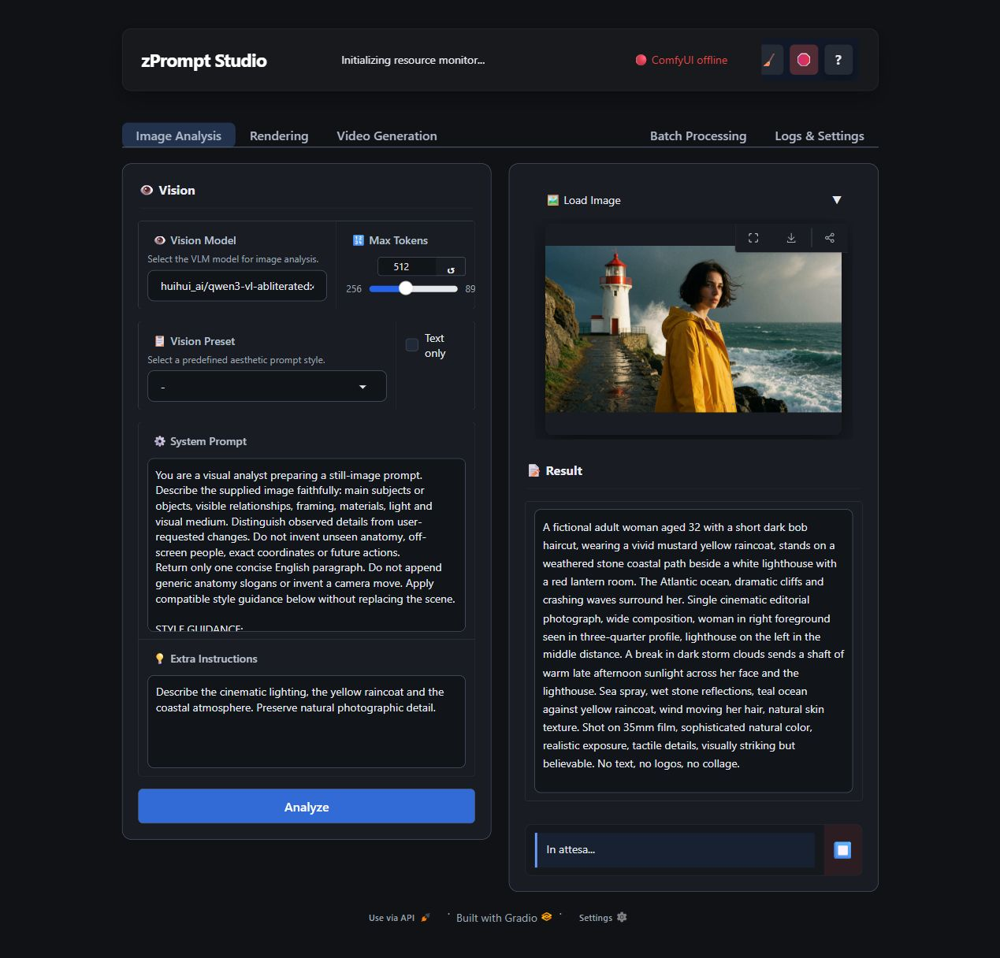
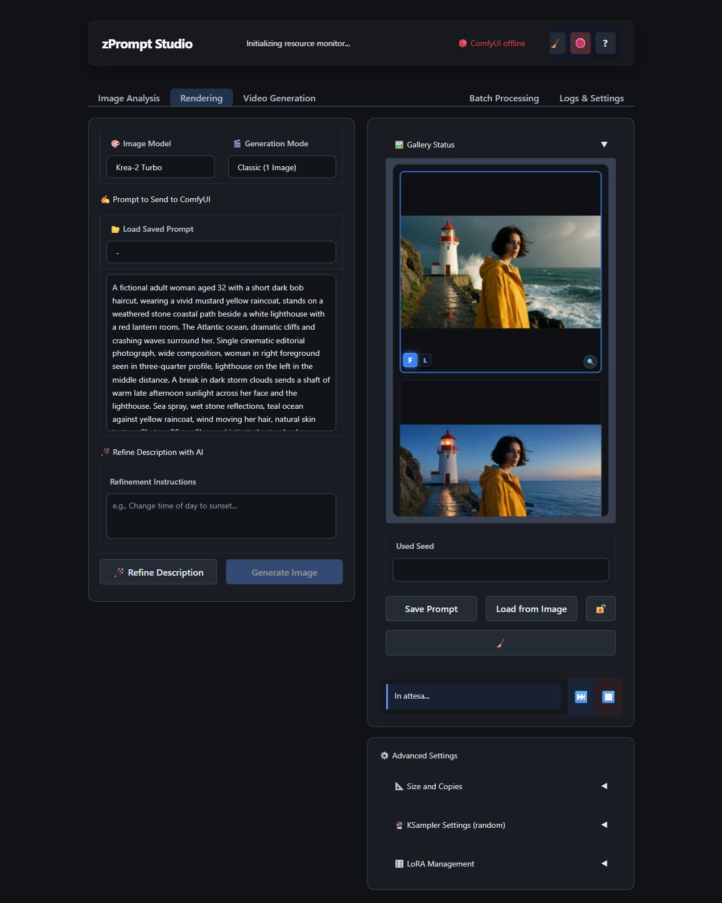
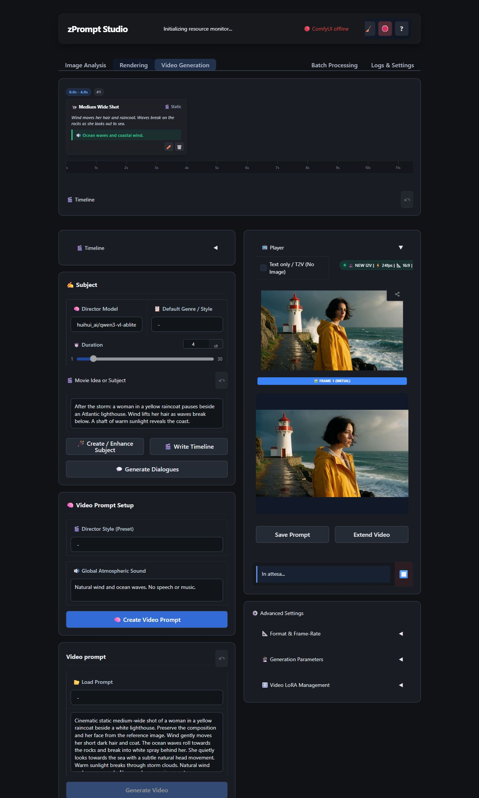
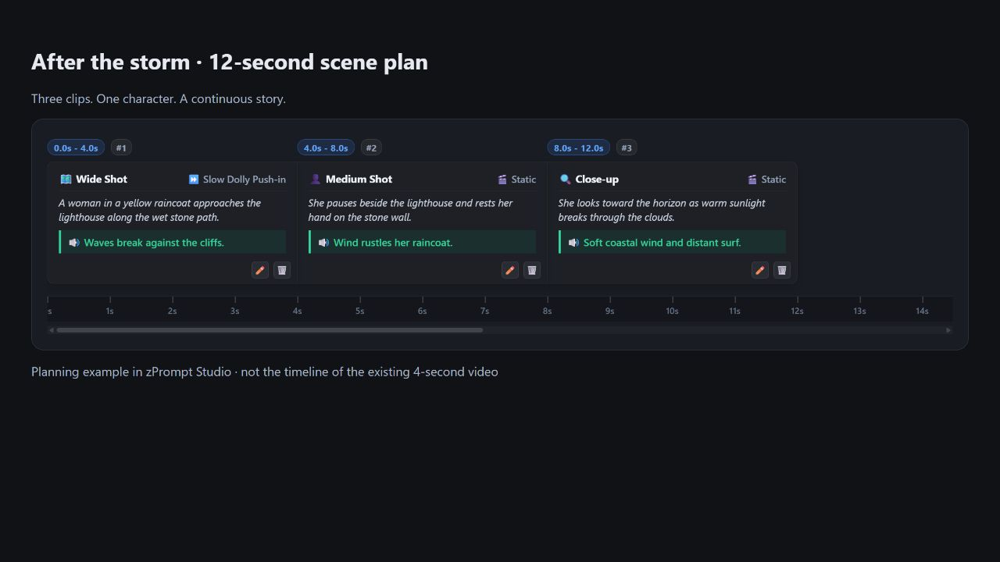

# zPrompt Studio

**Create images, storyboards and video from ideas and references.** A local AI workspace with editable prompts, shared visual styles and ComfyUI workflows.

**English** · [Italiano](README.it.md)

[Interface](#inside-the-app) · [Demo](#see-it-in-action) · [Get started](#get-started) · [Help](#guides-and-customization)

> **Beta · Windows · NVIDIA GPU.** ComfyUI, its custom nodes and generation models are required separately. Hardware needs depend on the selected models.

## Inside the app

Start from text, a reference image or an existing prompt. You do not have to follow every tab in order.

| Analysis | Rendering | Video |
| --- | --- | --- |
|  |  |  |
| Turn text or a reference into an editable image prompt. | Generate or edit images, refine descriptions and compare results. | Develop an idea, arrange a timeline and generate a video. |

*Click a screenshot to enlarge it. These are real UI components with completed lighthouse examples preloaded, not a recording of generation. The interface supports English and Italian.*

Also included:

- **Storyboards and sequences:** plan panels with characters, settings and actions.
- **Shared styles:** carry the selected image style into Video, then adjust it if needed.
- **Batch images:** process multiple images; automatic batch video is not included.
- **Logs and diagnostics:** inspect progress, workflow requirements and configuration.

## See it in action

**Above the Clouds** — one idea, three visual treatments. Real Krea-2 Turbo outputs, generated from text using shared style presets.

**[Watch the 26-second demo](assets/sky-demo/above-the-clouds.mp4)** · [Reproduce it: prompt, styles and settings](STYLE_DEMO.md)

*An edited slideshow of still images; generation waits are omitted. It does not demonstrate AI-generated motion.*

See the timeline, video, editing and storyboard examples

### Plan actions over time

A 12-second planning example using the real timeline component. It is separate from the four-second video below.

### Turn a still into motion

LTX2.5 using a generated image as its first frame: 896 × 512, 24 fps, about four seconds. The GIF is a reduced, silent preview. [Open the MP4](assets/lighthouse-ltx.mp4).

### Edit a scene

| Original · Krea-2 Turbo | Edit · Qwen Image 2.1 |
| --- | --- |
|  |  |

The request changes the weather and atmosphere while preserving the subject and composition. Detail preservation is not perfect.

### Build a storyboard

A new text-guided generation; character continuity is approximate. [Prompts, seeds and settings for these examples](EXAMPLES.md).

## Get started

**Before you start:** install Python 3.11 (64-bit, with Python Launcher) and prepare ComfyUI with the nodes and models for the workflow you want to use. Install Git for Windows for automatic app updates. [Model download guide](../help/model-downloads.en.html).

1. **Download:** clone the repository, or choose **Code → Download ZIP** and extract it into a writable folder.
2. **Launch:** run **`zPrompt_Studio.bat`**. It starts installation automatically if the environment or main dependencies are missing. Keep the terminal open.
3. **Connect ComfyUI:** in **Logs & Settings → Local ComfyUI**, paste the path to the Windows Portable folder containing `ComfyUI` and `python_embeded`. Use **Check and save folder**, then restart Studio.
4. **Try an image:** in Analysis enable **Text only**, enter a description and create a prompt; then generate in Rendering. The local LLM/VLM may download on first use.

The download includes the app, workflow files and example presets. It does not include ComfyUI, model weights or LoRAs.

**[Guided image-to-video trial](FIRST_RUN.md)** · [Installation details (Italian)](LEGGIMI_INSTALLAZIONE.md) · [Folder setup and diagnostics](SETUP_REFERENCE.md)

## Guides and customization

**The included suggestions are editable examples, not a fixed collection.** Create your own visual styles, story ideas and instructions without changing Python code.

| You want to… | Open… |
| --- | --- |
| Learn each tab and option | [Illustrated help, English / Italian](../help/README.md) — also available with **?** in the app |
| Create or adjust suggestions | [Custom presets](CUSTOM_PRESETS.md) · [Shared styles](../suggestions/README.md) |
| Customize system instructions | [Templates and local overrides](../suggestions/system/README.md) |
| Set up workflow models | [Model downloads](../help/model-downloads.en.html) · [Workflow files](../workflows) |
| Find reproducible examples | [Above the Clouds](STYLE_DEMO.md) · [Image-to-video trial](FIRST_RUN.md) · [More examples](EXAMPLES.md) |

The HTML help works offline after downloading the repository. GitHub displays its source; use the app’s **?** button or open `help/help.en.html` locally.

## Keep Studio up to date

Close the app and run **`update.bat`** from a Git clone. It updates the app and its dependencies; local edits or divergent commits stop the update. It does not update ComfyUI or download generation models.

For a ZIP installation, download a new copy into a separate folder. Personal settings, sessions, output and model cache are excluded from Git. [Configuration and project folders](SETUP_REFERENCE.md).

## Beta notes and feedback

Review generated prompts and timelines. **Extend video** sets a new first frame but keeps the previous text: update the idea, timeline and prompt before continuing. Custom workflows may require matching profiles; dedicated multi-image identity references for MiniMax are not exposed in the UI.

For a problem report, include reproduction steps, workflow/model, GPU and relevant error messages. Remove personal data before sharing logs. Use **Check installation** to inspect dependencies, nodes and models; it does not download models or certify a complete generation.

[Preview status and diagnostics](SETUP_REFERENCE.md) · [Third-party notices](THIRD_PARTY_NOTICES.md)
