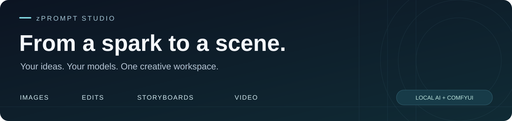

<b>Turn ideas and reference images into images, storyboards and video.</b> One Gradio workspace, powered by local models and ComfyUI.

<b>English</b> · <a href="README.it.md">Italiano</a>

[Installation](#try-it-on-windows) · [Offline guide (IT / EN)](../help/README.md) · [Examples](../docs/EXAMPLES.md)

> **Preview for installation testing.** ComfyUI and its models are installed separately. An NVIDIA GPU is the intended target for the supplied Windows dependency set.

## One idea. Three ways to tell it.

**After the storm** — a yellow raincoat, a lighthouse and a shaft of sunlight over the Atlantic. Generated locally with Krea-2 Turbo and the workflow included in the app.

## Inside the studio: one real example

**One reference. A connected workspace for prompts, images and motion.** These screenshots show the app’s actual UI components in an English demo session, with the lighthouse prompts and examples preloaded. The images and video are real outputs from the included workflows; this is not a recording of a fresh generation run.

### Give your reference a voice

Keep the reference, customizable instructions and image prompt side by side. Read and refine the details before generating.

### Watch the prompt take shape

Choose a workflow, refine the description and compare results in the gallery. F and L controls connect your images to video preparation.

### Bring the scene into motion

Develop the idea, timing, action and sound alongside the first frame. The player shows the example’s LTX2.5 video.

*Click any screenshot to view it at full size. The UI is also available in Italian.*

## More from the same project

### Change the atmosphere. Keep the scene.

| Original · Krea-2 Turbo | Edit · Qwen Image 2.1 |
| --- | --- |
|  |  |

The editing request: turn the storm into a peaceful evening while keeping the character, raincoat and composition. Compare the outputs: detail preservation is not perfect.

### From a scene to a storyboard

Three panels generated together with Krea-2 Turbo: approaching the lighthouse, entering it, looking out to sea. This is a new text-guided generation; character continuity is approximate.

**Real outputs from the included workflows, run through ComfyUI.** No stock photography. [Prompts, seeds and settings to try the examples →](../docs/EXAMPLES.md)

## From a still to motion

LTX2.5, using the Krea scene as its first frame: **896 × 512, 24 fps, 97 frames** (about 4 seconds). The GIF is a reduced, silent preview. [Open/download the MP4 video](../docs/assets/lighthouse-ltx.mp4).

| Area | What you can do |
| --- | --- |
| Analysis | Describe reference images and develop prompts with a local vision-language model. |
| Rendering | Generate images, refine prompts, select LoRAs and edit an existing image. |
| Storyboards & sequences | Plan panels and shots using character, setting and action descriptions. |
| Video | Develop an idea, timeline and final prompt, then run the selected ComfyUI video workflow. Input options depend on the workflow. |
| Batch | Process multiple images. Automatic batch video generation is not included. |
| Logs & settings | Configure paths and inspect workflow diagnostics. |

## Make the presets your own

**The included suggestions are examples prepared by the author: edit them, add your own and build a library that fits your creative style.** They are optional starting points, not a fixed collection.

Presets cover image analysis, direction, screenplay ideas, storyboards and sequences. They use plain text files; sequence catalogs also include characters, settings/outfits and actions. [How to create and customize presets →](../docs/CUSTOM_PRESETS.md)

## Try it on Windows

1. Install **Python 3.11 (64-bit)** with the Python Launcher. Install **Git for Windows** if you want automatic updates.
2. Clone this repository, or select **Code → Download ZIP** and extract it into a writable folder.
3. Run **`scripts/install.bat`**. It creates a local `venv`, installs dependencies and creates `data/settings.json` from the example without overwriting an existing file.
4. Edit **`data/settings.json`**: point `COMFYUI_DIR` at your ComfyUI portable directory and check `COMFYUI_URL`. Install the model files and custom nodes required by the workflows you want to use.
5. Run **`zPrompt_Studio.bat`**. Start with one image before testing longer workflows.

The repository includes source code, workflow JSON files and generic presets. It does **not** include ComfyUI, model weights, LoRAs or your previous sessions. LLM/VLM downloads may occur on first use; generation model weights must be available in ComfyUI. RAM, VRAM, disk space and download sizes depend on your chosen models.

**[Detailed installation notes in Italian](../docs/LEGGIMI_INSTALLAZIONE.md)** · **[Workflow files](../workflows)** · **[Configuration example](../config/settings.example.json)**

## Updates

Close the app and run **`update.bat`** from a Git clone. It fetches the configured upstream branch and only applies a fast-forward update, then installs the listed dependencies. Local edits or divergent commits stop the update. It does not update ComfyUI or download generation models.

ZIP downloads have no Git history: download a fresh copy into a separate folder instead. Settings, sessions, output and model cache are excluded from Git. Close any other zPrompt Studio instance if both use the same ComfyUI server.

## Preview status

- Dependency resolution was checked for Windows / Python 3.11; transitive versions are recorded in `scripts/constraints-win-py311.txt`.
- Workflow wiring and UI callbacks have been tested; a fresh installation and every model/workflow combination still need end-to-end testing.
- Offline manuals in Italian and English are bundled: use **?** and select the language, or open `help/help.html` / `help/help.en.html`.
- This is a private-review presentation. No public release or license grant is implied.

When reporting a problem, include the workflow/model, reproduction steps and relevant logs. Remove personal prompts, paths and credentials first.

The installer also checks Python, dependencies, GPU/CUDA, folders and ComfyUI. Repeat with `scripts/check_installation.bat` or **Logs & Settings → Diagnostics → Check installation**. Start ComfyUI to check workflow nodes and models. `CONFIG` means setup or further checks are needed for the desired features; checks do not download models or certify a complete generation.

System instructions can be customized without editing Python: see the [template and local override guide](../suggestions/system/README.md).

### Project folders

Start and update with the two `.bat` files in the main folder. Install with `scripts/install.bat`; run diagnostics with `scripts/check_installation.bat`. The small root `requirements.txt` preserves compatibility with older updaters.

- `config/`: model catalog, workflow parameters and example settings.
- `scripts/`: updater and dependency constraints.
- `docs/`: installation notes, third-party notices and file manifest.
- `workflows/`: API workflows and editable profiles.
- `suggestions/`: editable prompt instructions and examples.
- `help/`: illustrated user guide.

Personal settings and sessions are stored in `data/` and excluded from Git. Existing files are transferred automatically on startup. Installation and diagnostic tools are in `scripts/`.
