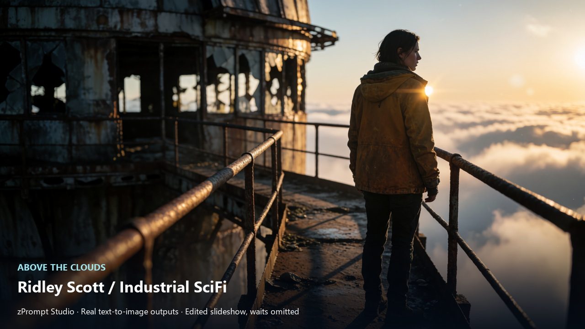
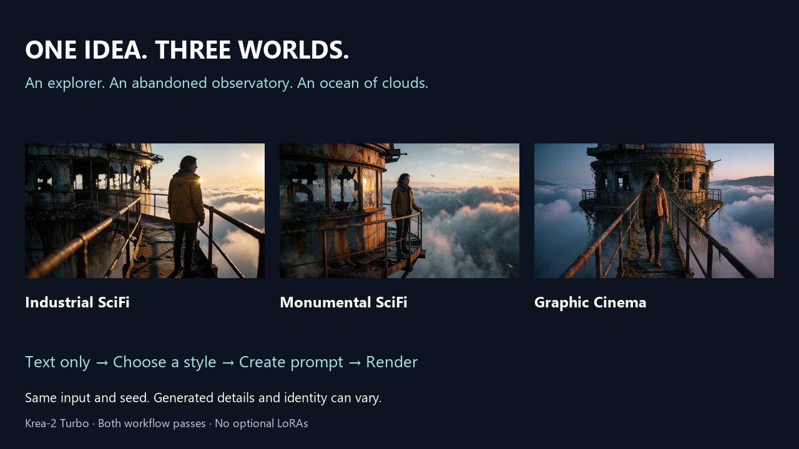

# Above the Clouds — una sola idea, tre mondi

[English](STYLE_DEMO.md)

**[Guarda la demo di 26 secondi](assets/sky-demo/above-the-clouds.mp4)** · [Prompt e tempi reali](assets/sky-demo/prompts.json)

Un’esploratrice in giacca ambra raggiunge un osservatorio abbandonato sopra un oceano di nuvole. Tre interpretazioni della stessa idea, generate davvero con Studio. Il filmato è un montaggio di immagini statiche: non è un video animato dall’AI e le attese sono omesse.

## Riproduci la prova

1. In Analisi attiva **Solo testo** e incolla la descrizione qui sotto.
2. Seleziona **09_Ridley_Scott_Industrial_SciFi** e crea il prompt con Qwen3-VL 4B abliterated, limite 320 token.
3. In Rendering usa **Krea-2 Turbo**, modalità classica, una copia, **1536 × 864**, seed fisso **12112026** e nessun LoRA opzionale. Mantieni entrambe le fasi del workflow.
4. Ripeti con **10_Denis_Villeneuve_Monumental_SciFi** e **11_Wes_Anderson_Graphic_Cinema**, senza cambiare descrizione e impostazioni.

> A lone adult female explorer in an amber jacket reaches an abandoned observatory along a narrow elevated walkway above an ocean of clouds at sunset. Live-action cinematic photography. Show both the explorer and the observatory, with a clear sense of height and depth. No other people, no text.

## Cosa confrontare

Luce, materiali, palette e composizione. I prompt sono prodotti dall’LLM senza riscrittura manuale. Lo stesso seed non blocca l’identità del personaggio né l’architettura: i dettagli possono cambiare. Il JSON riporta i tempi misurati, compreso il caricamento dove applicabile; hardware e cache influiscono sulle attese.

Scegliendo lo stile in Analisi viene selezionato anche quello corrispondente nel Video. Puoi modificarlo; i testi già creati non vengono riscritti.

[Prova tecnica precedente e correzione del preset](STYLE_TECHNICAL.it.md)

Le annotazioni esplicite sul rapporto d’aspetto inviate ai workflow immagine standard ora seguono le dimensioni selezionate. I prompt della demo restano gli output originali, non modificati.
