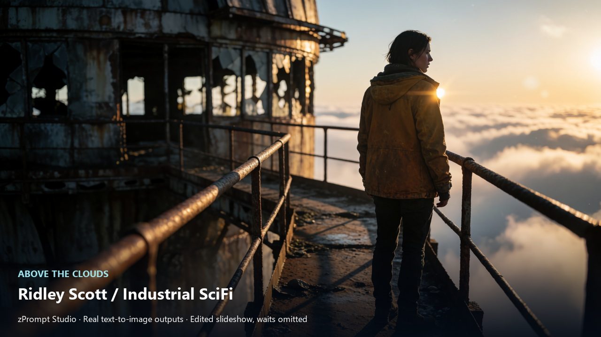
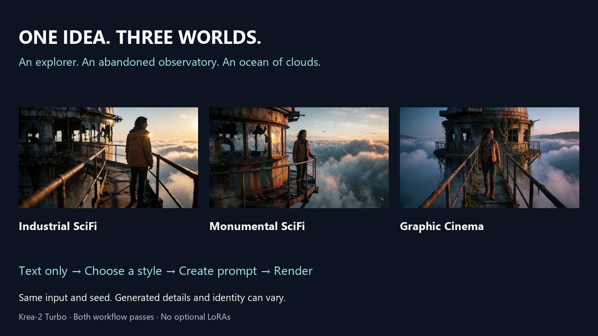

# Above the Clouds — one idea, three worlds

[Italiano](STYLE_DEMO.it.md)

**[Watch the 26-second demo](assets/sky-demo/above-the-clouds.mp4)** · [Actual prompts and timings](assets/sky-demo/prompts.json)

An explorer in an amber jacket reaches an abandoned observatory above an ocean of clouds. Three real Studio interpretations of the same idea. This is an edited slideshow of still images, not AI-generated motion; generation waits are omitted.

## Reproduce the trial

1. Enable **Text only** in Analysis and paste the description below.
2. Select **09_Ridley_Scott_Industrial_SciFi** and create the prompt with Qwen3-VL 4B abliterated, output limit 320 tokens.
3. In Rendering use **Krea-2 Turbo**, classic mode, one copy, **1536 × 864**, fixed seed **12112026**, and no optional LoRAs. Keep both workflow passes.
4. Repeat with **10_Denis_Villeneuve_Monumental_SciFi** and **11_Wes_Anderson_Graphic_Cinema**, keeping the description and settings unchanged.

> A lone adult female explorer in an amber jacket reaches an abandoned observatory along a narrow elevated walkway above an ocean of clouds at sunset. Live-action cinematic photography. Show both the explorer and the observatory, with a clear sense of height and depth. No other people, no text.

## What to compare

Lighting, materials, palette and composition. The LLM prompts were not manually rewritten. A shared seed does not lock character identity or architecture: generated details can vary. The JSON includes measured timings, including loading where applicable; hardware and caching affect waits.

Choosing the Analysis style also selects its matching Video direction preset. You can override it; existing text is not rewritten.

[Previous technical trial and preset correction](STYLE_TECHNICAL.md)
