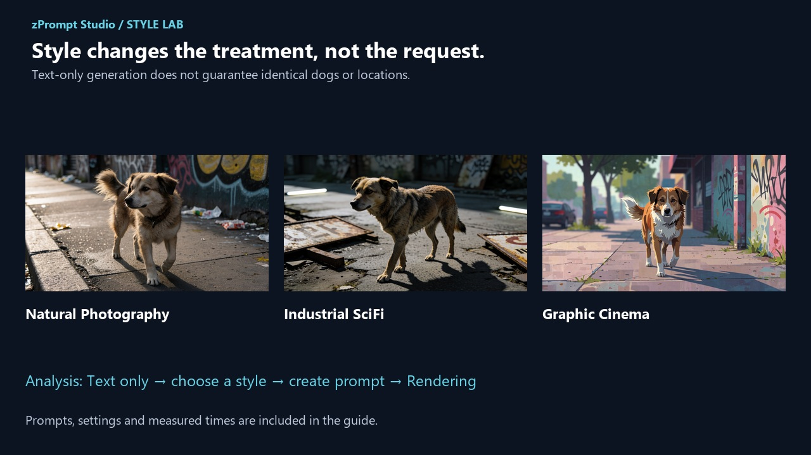

# One idea, three visual treatments

[Italiano](STYLE_DEMO.it.md)

**[Watch the 27-second comparison](assets/style-demo/styles.mp4)** · [Exact prompts and measured times](assets/style-demo/prompts.json)

This is an edited slideshow of real outputs generated through Studio's prompt and rendering functions, not a screen recording. Generation waits are omitted. No reference image or optional LoRA was used. The prompts were not manually rewritten for the demo.

## Try it yourself

1. In **Analysis**, enable **Text only** and enter `A dog on a street.` in the description field.
2. Choose **01_Natural_Photography** and create the prompt. Read the resulting lighting, color and composition instructions.
3. In **Rendering**, use Krea-2 Turbo, classic single-image mode, one copy, 1024 × 576 and fixed seed **12112026**. Keep both workflow passes and no optional LoRAs. Generate.
4. Repeat with **09_Ridley_Scott_Industrial_SciFi**, then **11_Wes_Anderson_Graphic_Cinema**, keeping the input and render settings unchanged.

The prompt model used here is Qwen3-VL 4B abliterated, with a 320-token output limit. Actual elapsed times, including model loading where applicable, are in the accompanying JSON. Hardware, caching and model versions affect timing and results. The fixed image seed does not make LLM prompt generation deterministic.

## What to look for

Compare lighting, palette, texture and composition. A style supplies visual instructions; it does not guarantee a particular result. With such a short text-only idea, the LLM must fill in unspecified details: the dog and street can differ. This is a practical end-to-end example, not a controlled identity-preservation benchmark.

The matching Video direction style is selected automatically when you choose the image style in Analysis. You can override it in Video; existing ideas, timelines and prompts are not rewritten. This comparison itself contains still images, not AI-generated video motion.

### Observed result

Natural Photography produced a photographic street scene; Industrial SciFi emphasized darker lighting and distressed surfaces. Graphic Cinema produced an illustration-like result rather than a live-action film look. This reveals an ambiguity in how the generation model interpreted the visual wording; it is not proof of faithful director-style reproduction. All three prompts added unspecified details. For tighter control, describe the dog and setting explicitly and request live-action photography when desired.
